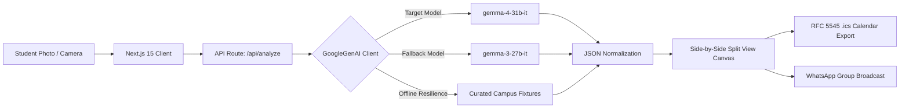

# 🔍 AccessLens: Intelligent Campus Notice Parser

[](https://github.com/SynthReaper/AccessLens/actions)
[](https://opensource.org/licenses/MIT)
[--38bdf8)](https://ai.google.dev/gemma)
[](https://hacktoberfest-handbook.mlh.com)

> **One-Line Pitch:** Take a photo of a campus notice, flyer, or event poster; **AccessLens** turns it into structured, verifiable, action-ready intelligence using Google **Gemma 4**'s multimodal vision capabilities through the Gemini API.

Built for **Hacktoberfest 2026 × MUJ**:

- 🎯 **Challenge 1:** Best Use of Gemma 4 (Multimodal image-to-action reasoning)
- 🎯 **Challenge 2:** Best Open-Source AI Project (Public repository, issue-driven development, CI pipeline)

---

## 🌟 Why AccessLens?

Students frequently encounter crucial campus information pinned to physical noticeboards, taped to elevator doors, or shared as compressed photos on WhatsApp:

- Event dates, room shifts, audition cutoffs, fee deadlines, library hour adjustments.
- These notices are often cluttered, poorly lit, or have torn corners.
- Students miss deadlines because extracting "What do I actually need to do?" requires deciphering paragraphs of fine print.

**AccessLens** solves this with **Gemma 4's multimodal understanding**:

1. **Plain-Language Summary:** Injects clarity before students get overwhelmed by fine print.
2. **Confirmed Logistics:** Cleanly isolates Title, Venue, Date, Time, Organizer, and Registration link.
3. **Action Items & Deadlines:** Extracts only the concrete actions students must take.
4. **Zero-Hallucination Uncertainty Detection:** Explicitly flags torn, cropped, or ambiguous text as `unknown` rather than fabricating details.
5. **Side-by-Side Verification:** Places the original photo right next to the extracted cards with zoom controls so users can verify critical information with zero friction.
6. **Action Toolbar:** One-click `.ics` calendar download, markdown copy, and WhatsApp group sharing.

---

## 🔬 Gemma Integration & Code Verification

As instructed in the [MLH Gemma Hack Day guidelines](https://hacktoberfest-handbook.mlh.com/hack-days-partner-modules/partner-challenge-google-gemma), judges can inspect the actual model calls directly in the codebase:

- **Primary Multimodal Client:** [`src/lib/gemma-client.ts`](file:///d:/Competition/Hackathons/HackOctoberXMUJ/src/lib/gemma-client.ts)
  - Uses the official `@google/genai` SDK (`GoogleGenAI`).
  - Calls `gemma-4-31b-it` with image `inlineData` and JSON schema enforcement.
  - Features dual-track resilience: if `gemma-4-31b-it` experiences upstream limits, it falls back to `gemma-3-27b-it`.
- **API Endpoint:** [`src/app/api/analyze/route.ts`](file:///d:/Competition/Hackathons/HackOctoberXMUJ/src/app/api/analyze/route.ts)
- **Live Model Attribution Badge:** [`src/components/ModelBadge.tsx`](file:///d:/Competition/Hackathons/HackOctoberXMUJ/src/components/ModelBadge.tsx) displays the exact model ID and inference latency for every result.
- **Fail-Safe Stage Demo Fixtures:** Pre-baked realistic campus notices ensure live presentations on stage at MUJ never fail due to campus Wi-Fi drops.

---

## 🏗️ System Architecture



---

## 🚀 Quickstart & Setup

### Prerequisites

- Node.js 20+ (tested on Node 20 & 24)
- npm 10+
- (Optional) Google Gemini API Key with Gemma access from [Google AI Studio](https://aistudio.google.com/)

### 1. Clone & Install

```bash
git clone https://github.com/SynthReaper/AccessLens.git
cd accesslens
npm install
```

### 2. Configure Environment

Copy the `.env.example` file to `.env.local`:

```bash
cp .env.example .env.local
```

Add your Gemini API key in `.env.local`:

```env
GEMINI_API_KEY=your_actual_key_here
GEMMA_PRIMARY_MODEL=gemma-4-31b-it
GEMMA_FALLBACK_MODEL=gemma-3-27b-it
ENABLE_DEMO_FALLBACKS=true
```

*(Note: If no key is set, AccessLens automatically runs in resilient demo mode with instant verified campus test samples).*

### 3. Run Development Server

```bash
npm run dev
```

Open [http://localhost:3000](http://localhost:3000) in your browser.

### 4. Run Automated Tests & Linter

```bash
# Run unit tests (RFC 5545 calendar & schema fixtures)
npm test

# Run ESLint check
npm run lint

# Run Next.js production build
npm run build
```

---

## ✨ Feature Suite

1. **Gemma 4 Multimodal Vision Extraction**: 2D coordinate bounding boxes (`[ymin, xmin, ymax, xmax]`), zero-hallucination uncertainty detection for torn/cropped notices, plain-language summaries, logistics parsing.
2. **Client-Side QR Code Engine**: Detects QR registration codes directly inside notice images via `jsQR` with interactive pin overlays.
3. **Web Speech Synthesizer ("Read Aloud")**: Voice accessibility for visually impaired students.
4. **MUJ Campus Wayfinder**: Built-in interactive map linking detected venues (Academic Blocks AB1/AB2/AB3, Sanganane Auditorium, Central Library) with walking directions and Google Maps pins.
5. **Interactive Notice Q&A Assistant (`/api/ask`)**: Multi-turn contextual querying over notice content powered by Gemma 4.
6. **Discord Webhook Broadcaster (`/api/broadcast`)**: 1-click rich embed broadcast directly into student clubs and batch Discord servers.
7. **Document Contrast Enhancer**: In-browser image processing filter boosting low-light or wrinkled notice legibility.
8. **Export Toolkit**: RFC 5545 `.ics` calendar sync, markdown summary export, and direct WhatsApp group forwarder.

---

## 📋 Open-Source Compliance & GitHub History

AccessLens is developed transparently according to Hacktoberfest × MUJ guidelines:

- **MIT License:** Included in [`LICENSE`](./LICENSE).
- **Issue #1 (Team Registration):** Full registration log documented in [`docs/ISSUES_AND_PRS.md`](./docs/ISSUES_AND_PRS.md).
- **Issue Tracking:** Issues `#2` through `#7` track multimodal API, mobile camera, split view, calendar export, high-impact accessibility features, and CI/CD.
- **CI Workflow:** Automated build and test on every PR in [`.github/workflows/ci.yml`](./.github/workflows/ci.yml).

---

## 👥 Authors & Attribution

- **Aditya Goyal (@SynthReaper)**
  - Role: Solo Developer & Architect
  - Institution: Manipal University Jaipur (MUJ)
  - GitHub: [SynthReaper](https://github.com/SynthReaper)
- Built for **Hacktoberfest 2026 × MUJ** (October 2026).

