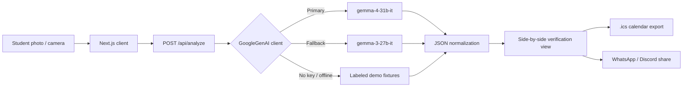

# 🔍 AccessLens: Campus Notice Parser

[](https://github.com/SynthReaper/AccessLens/actions)
[](https://opensource.org/licenses/MIT)
[-338bdf)](https://ai.google.dev/gemma)
[](https://hacktoberfest-handbook.mlh.com)

> **Take a photo of a campus notice, flyer, or event poster. AccessLens turns it into structured, verifiable, action-ready information using Google's open-weights Gemma 4 vision model through the Gemini API.**

**Live demo:** https://accesslens-sr.vercel.app/

Built for **Hacktoberfest Hack Day Jaipur × MUJ (2026)**:

- 🎯 **Best Use of Gemma 4**: multimodal image-to-action reasoning
- 🎯 **Best Open-Source AI Project**: open-weights model at the core, public MIT repo, CI pipeline

---

## 🌟 Why AccessLens?

Important campus information often lives on physical noticeboards, elevator doors, or compressed WhatsApp photos. Event dates, room changes, audition cutoffs, and fee deadlines are buried in cluttered, badly lit, sometimes torn notices, and students miss them.

AccessLens answers one question: **"What do I actually need to do?"**

1. **Plain-language summary** of the notice, without the fine print.
2. **Confirmed logistics:** title, venue, date, time, organizer, registration link.
3. **Action items and deadlines:** only the concrete things a student must do.
4. **Uncertainty flagging:** text that is torn, cropped, or ambiguous is marked `unknown` instead of guessed.
5. **Side-by-side verification:** the original photo sits next to the extracted cards, with zoom, so users can check critical details quickly.
6. **One-click actions:** `.ics` calendar download, Markdown copy, WhatsApp share, Discord broadcast.

---

## 🔬 Where Gemma 4 is used

The model calls live in plain sight so they are easy to inspect:

| What | Where |
| --- | --- |
| Multimodal client (image + JSON schema) | [`src/lib/gemma-client.ts`](src/lib/gemma-client.ts) |
| Analyze endpoint | [`src/app/api/analyze/route.ts`](src/app/api/analyze/route.ts) |
| Notice Q&A endpoint | `src/app/api/ask` |
| Live model attribution (model ID + latency) | [`src/components/ModelBadge.tsx`](src/components/ModelBadge.tsx) |

- Uses the official `@google/genai` SDK.
- Primary model: `gemma-4-31b-it`, called with image `inlineData` and an enforced JSON response schema.
- Fallback model: `gemma-3-27b-it`, used only if the primary hits upstream limits.
- Every result shows the model that actually produced it, so you can tell Gemma output from a fallback or a demo fixture.

### Demo mode

If no `GEMINI_API_KEY` is set (or `ENABLE_DEMO_FALLBACKS` is on and the API is unreachable), AccessLens serves pre-verified sample notices so a presentation never depends on campus Wi-Fi. Results from fixtures are labeled as such in the UI. Uploading your own photo with a valid key always goes through the model.

---

## 🏗️ Architecture



---

## ✨ Features

- **Gemma 4 vision extraction:** bounding boxes (`[ymin, xmin, ymax, xmax]`), summaries, logistics, action items, and `unknown` flags for unreadable fields.
- **QR detection:** finds registration QR codes in the image client-side with `jsQR` and pins them on the photo.
- **Read Aloud:** Web Speech synthesis for visually impaired students.
- **MUJ Campus Wayfinder:** links detected venues (AB1/AB2/AB3, Sanganane Auditorium, Central Library) to directions and map pins.
- **Notice Q&A (`/api/ask`):** multi-turn questions over the extracted notice, powered by Gemma 4.
- **Discord broadcaster (`/api/broadcast`):** posts a rich embed to a club or batch server via webhook.
- **Contrast enhancer:** in-browser filter to improve legibility of dim or wrinkled notices.
- **Export toolkit:** RFC 5545 `.ics` calendar file, Markdown summary, WhatsApp share.

---

## 🚀 Quickstart

**Prerequisites:** Node.js 20+, npm 10+, and (optionally) a Gemini API key with Gemma access from [Google AI Studio](https://aistudio.google.com/).

```bash
git clone https://github.com/SynthReaper/AccessLens.git
cd AccessLens
npm install
cp .env.example .env.local
```

Edit `.env.local`:

```bash
GEMINI_API_KEY=your_key_here
GEMMA_PRIMARY_MODEL=gemma-4-31b-it
GEMMA_FALLBACK_MODEL=gemma-3-27b-it
ENABLE_DEMO_FALLBACKS=true
```

Run it:

```bash
npm run dev        # http://localhost:3000
```

Without a key the app starts in demo mode with sample notices.

### Tests and checks

```bash
npm test           # unit tests: RFC 5545 calendar export, schema fixtures
npm run lint       # ESLint
npm run build      # Next.js production build
```

---

## ⚠️ Limitations

- AccessLens reduces guessing by flagging unreadable text as `unknown`, but model output can still contain mistakes. That is why the original image is always shown beside the extraction. Check dates and deadlines before relying on them.
- Accuracy drops on heavily damaged, very small, or low-resolution text.
- The campus wayfinder currently covers MUJ venues only.

---

## 🤝 Contributing

The project is open source under the MIT license, and contributions are welcome.

1. Pick an open issue (or open one describing the change).
2. Fork, branch, and make your change.
3. Run `npm test`, `npm run lint`, and `npm run build`.
4. Open a pull request that references the issue. CI runs the same checks on every PR ([`.github/workflows/ci.yml`](.github/workflows/ci.yml)).

Project background and the original issue plan are in [`docs/ISSUES_AND_PRS.md`](docs/ISSUES_AND_PRS.md). Agent-specific repo notes are in [`AGENTS.md`](AGENTS.md).

---

## 📄 License

[MIT](LICENSE)

## 👤 Author

**Aditya Goyal** ([@SynthReaper](https://github.com/SynthReaper)), Manipal University Jaipur. Built solo for Hacktoberfest 2026 × MUJ.
